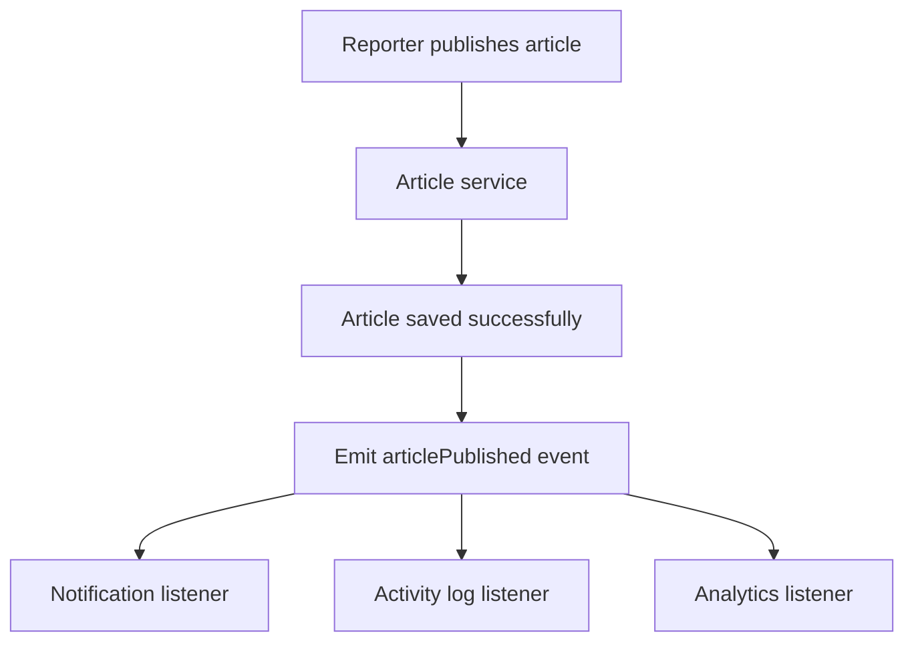
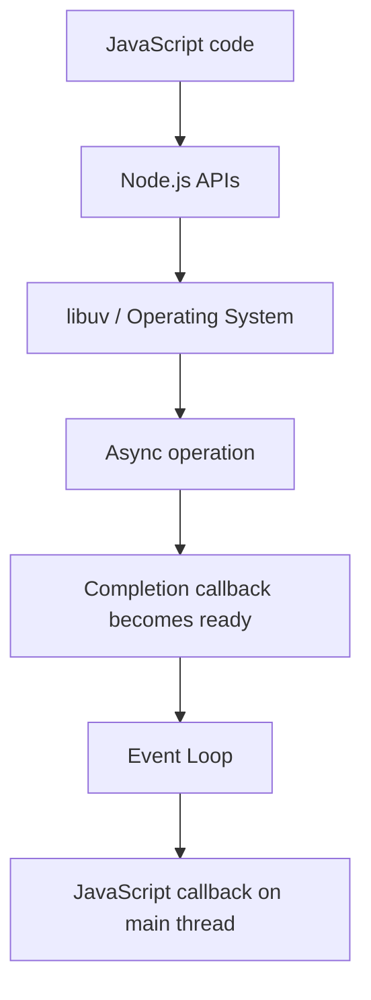
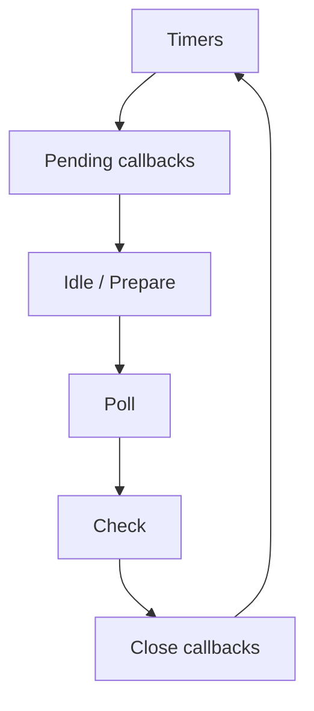
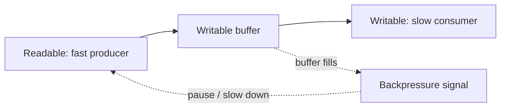

# Node.js Internals: Event Loop, Events, Streams & Modules

> **বাংলায় Node.js শেখার একটি Practical Guide — Beginner থেকে Advanced**  
> এই README-তে Node.js-এর Event-Driven Architecture, EventEmitter, Event Listener, Callback, Single-threaded execution, libuv, Event Loop, Buffers, Streams, IIFE, CommonJS, Module Alias এবং ES Modules (ESM) ধাপে ধাপে আলোচনা করা হয়েছে। প্রতিটি বিষয়ের সঙ্গে JavaScript উদাহরণ ও বাস্তব Backend Project-এ প্রয়োগ দেখানো হয়েছে।


---

## সূচিপত্র

1. [এই Guide থেকে কী শিখবে](#এই-guide-থেকে-কী-শিখবে)
2. [শুরু করার আগে](#শুরু-করার-আগে)
3. [Node.js-এর সংক্ষিপ্ত পরিচিতি](#1-nodejs-এর-সংক্ষিপ্ত-পরিচিতি)
4. [Event-Driven Architecture](#2-event-driven-architecture)
5. [EventEmitter, Event Listener ও Callback](#3-eventemitter-event-listener-ও-callback)
6. [Single-threaded Node.js বনাম Multithreaded Server](#4-single-threaded-nodejs-বনাম-multithreaded-server)
7. [libuv, Thread Pool ও Worker Threads](#5-libuv-thread-pool-ও-worker-threads)
8. [Node.js Event Loop](#6-nodejs-event-loop)
9. [Buffer](#7-buffer)
10. [Streams](#8-streams)
11. [Backpressure ও Pipeline](#9-backpressure-ও-pipeline)
12. [Modular System ও IIFE](#10-modular-system-ও-iife)
13. [CommonJS](#11-commonjs-module-system)
14. [CommonJS Module Wrapper](#12-commonjs-module-wrapper)
15. [Module Alias](#13-module-alias)
16. [ES Modules (ESM)](#14-es-modules-esm)
17. [CommonJS থেকে ESM-এ Migration](#15-commonjs-থেকে-esm-এ-migration)
18. [Somporko Backend-এ বাস্তব প্রয়োগ](#16-somporko-backend-এ-বাস্তব-প্রয়োগ)
19. [সাধারণ ভুল ও সতর্কতা](#17-সাধারণ-ভুল-ও-সতর্কতা)
20. [Practice Problems](#18-practice-problems)
21. [Practice Solution](#19-practice-solution)
22. [দ্রুত Revision Sheet](#20-দ্রুত-revision-sheet)
23. [Official Documentation](#21-official-documentation)

---

## এই Guide থেকে কী শিখবে

এই Guide শেষ করলে তুমি বুঝতে পারবে:

- Event-driven application কীভাবে কাজ করে।
- EventEmitter দিয়ে custom event তৈরি, emit এবং listen করা যায় কীভাবে।
- Event Listener কেন Callback Function-এর একটি বিশেষ ব্যবহার।
- Node.js-এর JavaScript execution সাধারণত single main thread-এ হলেও কীভাবে অনেক I/O request handle করে।
- libuv, Event Loop, Thread Pool এবং Worker Threads-এর ভূমিকা কী।
- Call Stack, Microtask, `process.nextTick()`, Timer ও Event Loop Phase কীভাবে সম্পর্কিত।
- Binary data Buffer-এ কীভাবে রাখা হয়।
- Stream দিয়ে বড় file বা data chunk-by-chunk কীভাবে process করা হয়।
- Backpressure কেন হয় এবং কীভাবে handle করতে হয়।
- IIFE ও Closure দিয়ে private scope তৈরি করা যায় কীভাবে।
- CommonJS-এর `require()`, `module.exports` এবং module caching কীভাবে কাজ করে।
- Module Alias কী এবং TypeScript `paths` কেন runtime-এ নিজে থেকে কাজ করে না।
- Modern ESM-এর `import`, `export`, `import.meta.url` এবং Dynamic Import কীভাবে ব্যবহার করতে হয়।

## শুরু করার আগে

### প্রয়োজনীয় জ্ঞান

এই Guide অনুসরণ করার আগে JavaScript-এর নিচের বিষয়গুলো সম্পর্কে প্রাথমিক ধারণা থাকলে সুবিধা হবে:

- Variable, Function ও Object
- Array এবং Array Method
- Callback Function
- Promise ও `async/await`
- Basic Terminal Command

### Node.js পরীক্ষা

প্রথমে Node.js ইনস্টল আছে কি না যাচাই করো:

```bash
node --version
npm --version
```

একটি নতুন folder তৈরি করে সেখানে প্রবেশ করো:

```bash
mkdir nodejs-internals-practice
cd nodejs-internals-practice
npm init -y
```

JavaScript file চালাতে:

```bash
node filename.js
```

> **নোট:** এই Guide-এর প্রথম দিকের CommonJS উদাহরণগুলো `.cjs` file-এ অথবা CommonJS-এ configured project-এ চালানো যাবে। ESM উদাহরণের জন্য `"type": "module"` ব্যবহার করা হবে। একই project-এ দুই format থাকলে `.cjs` ও `.mjs` extension ব্যবহার করে দ্ব্যর্থতা এড়ানো যায়।

---

# 1. Node.js-এর সংক্ষিপ্ত পরিচিতি

Node.js হলো JavaScript runtime environment। এটি Browser-এর বাইরে, যেমন Server, Command Line Tool, Automation এবং Backend Application-এ JavaScript চালাতে সাহায্য করে। Node.js Google-এর V8 JavaScript Engine ব্যবহার করে এবং asynchronous I/O-এর জন্য libuv-সহ runtime infrastructure ব্যবহার করে।

### Browser JavaScript ও Node.js-এর পার্থক্য

| বিষয় | Browser | Node.js |
|---|---|---|
| প্রধান ব্যবহার | Web Page ও UI | Server, CLI, tooling, automation |
| DOM API | সাধারণত থাকে | Built-in DOM নেই |
| File System Access | Browser security boundary-এর মধ্যে সীমিত | `node:fs` দিয়ে server-side file access |
| Module System | ESM ও browser tooling | CommonJS এবং ESM |
| Network | `fetch`, WebSocket ইত্যাদি | HTTP, TCP, `fetch`, WebSocket package ইত্যাদি |

Node.js শুধু Backend-এর জন্য নয়; Build Tool, CLI এবং Development Tool তৈরিতেও ব্যবহার করা হয়।

---

# 2. Event-Driven Architecture

## 2.1 Event-Driven Architecture কী?

Event-Driven Architecture (EDA) এমন একটি Software Architecture, যেখানে কোনো ঘটনা বা **Event** ঘটলে Application-এর এক বা একাধিক অংশ সেই ঘটনা অনুযায়ী কাজ করে।

উদাহরণ: Somporko News Portal-এ একজন Reporter Article Publish করল। এরপর:

1. Article Database-এ save করা হতে পারে।
2. Admin notification পেতে পারেন।
3. Subscriber-দের email পাঠানো হতে পারে।
4. Activity log তৈরি হতে পারে।

এখানে `articlePublished` হলো একটি Event।

### Event-driven flow



## 2.2 মূল ধারণাগুলো

| ধারণা | অর্থ |
|---|---|
| Event | কোনো ঘটনা বা state change-এর সংকেত |
| Publisher / Producer | Event তৈরি বা publish করে |
| Event Emitter | Event emit ও listener পরিচালনার object/API |
| Listener / Subscriber | নির্দিষ্ট Event-এর জন্য অপেক্ষমাণ function |
| Callback | অন্য function-এ argument হিসেবে দেওয়া function |

Event-driven design-এ Publisher-কে Listener-এর সম্পূর্ণ implementation জানতে হয় না। এতে code-এর coupling কমানো যায়।

## 2.3 EventEmitter-এর সীমাবদ্ধতা

Node.js-এর `EventEmitter` একই process-এর ভিতরে event dispatch করার জন্য। এটি নিজে কোনো distributed message broker নয়। একাধিক server instance-এর মধ্যে event share করতে Redis Pub/Sub, RabbitMQ, Kafka বা অন্য messaging system-এর মতো solution প্রয়োজন হতে পারে।

---

# 3. EventEmitter, Event Listener ও Callback

এই তিনটি বিষয় একে অপরের সঙ্গে সম্পর্কিত, কিন্তু একই জিনিস নয়।

## 3.1 EventEmitter কী?

`EventEmitter` হলো Node.js-এর `node:events` module-এর একটি Class। এর instance দিয়ে custom event emit করা এবং event-এর listener register করা যায়।

```js
// events-demo.cjs
const EventEmitter = require('node:events');

const eventEmitter = new EventEmitter();
```

এখানে:

- `EventEmitter` হলো Class।
- `new EventEmitter()` একটি instance তৈরি করে।
- `eventEmitter` object-এর মাধ্যমে `.on()` ও `.emit()` ব্যবহার করা যাবে।

## 3.2 Event Listener কী?

Event Listener হলো এমন function, যেটি নির্দিষ্ট event-এর জন্য register করা থাকে। Event emit হলে সেটি call হয়।

```js
eventEmitter.on('articlePublished', () => {
  console.log('A new article has been published!');
});

eventEmitter.emit('articlePublished');
```

Output:

```text
A new article has been published!
```

- `.on()` listener register করে।
- `.emit()` event trigger করে।
- Event name একই হতে হবে।

## 3.3 Event-এর সঙ্গে data পাঠানো

```js
const EventEmitter = require('node:events');
const articleEvents = new EventEmitter();

articleEvents.on('articlePublished', (article) => {
  console.log('Title:', article.title);
  console.log('Reporter:', article.reporter);
});

articleEvents.emit('articlePublished', {
  title: 'Understanding Node.js',
  reporter: 'Sohan',
});
```

Output:

```text
Title: Understanding Node.js
Reporter: Sohan
```

`.emit()`-এর event name-এর পর দেওয়া argument-গুলো listener function-এর parameter হিসেবে যায়।

## 3.4 Callback Function কী?

Callback হলো এমন function, যেটি অন্য একটি function-এর argument হিসেবে পাঠানো হয় এবং সেই function প্রয়োজন অনুযায়ী call করে।

```js
function greeting(name, callback) {
  console.log(`Hello ${name}`);
  callback();
}

function sayWelcome() {
  console.log('Welcome to Node.js!');
}

greeting('Sohan', sayWelcome);
```

Output:

```text
Hello Sohan
Welcome to Node.js!
```

এখানে `sayWelcome` হলো Callback Function।

> **মনে রাখবে:** Callback মানেই asynchronous function নয়। Callback synchronous বা asynchronous—দুই রকমই হতে পারে। Event Listener হলো event-এর সঙ্গে register করা একটি Callback-এর ব্যবহার। কিন্তু সব Callback Event Listener নয়।

## 3.5 Synchronous Callback ও Asynchronous Callback

### Synchronous callback

```js
function processUser(name, callback) {
  console.log('Processing:', name);
  callback();
}

processUser('Sohan', () => {
  console.log('Callback executed');
});

console.log('Program finished');
```

Output:

```text
Processing: Sohan
Callback executed
Program finished
```

Callback একই call sequence-এর মধ্যে সঙ্গে সঙ্গে execute হয়েছে।

### Asynchronous callback

```js
const fs = require('node:fs');

console.log('Before file read');

fs.readFile('./message.txt', 'utf8', (error, data) => {
  if (error) {
    console.error(error);
    return;
  }

  console.log('File content:', data);
});

console.log('After starting file read');
```

File read শেষ হলে callback execute হবে। তাই সাধারণত `After starting file read` আগে দেখা যায়।

## 3.6 `on()`, `once()`, `off()` ও `emit()`

```js
const EventEmitter = require('node:events');
const emitter = new EventEmitter();

function welcome() {
  console.log('Welcome to Somporko!');
}

// Listener register
emitter.on('userRegistered', welcome);

// Event trigger
emitter.emit('userRegistered');

// Listener remove
emitter.off('userRegistered', welcome);

// একবারের জন্য listener
emitter.once('firstVisit', () => {
  console.log('This message appears once.');
});

emitter.emit('firstVisit');
emitter.emit('firstVisit');
```

| Method | কাজ |
|---|---|
| `on(event, listener)` | Listener register করে |
| `addListener(event, listener)` | `on()`-এর সমতুল্য |
| `once(event, listener)` | প্রথমবার event এলে listener সরিয়ে দেয় |
| `off(event, listener)` | নির্দিষ্ট listener সরায় |
| `removeListener(event, listener)` | নির্দিষ্ট listener সরায় |
| `removeAllListeners(event)` | নির্দিষ্ট event-এর listener সরায় |
| `emit(event, ...args)` | Event emit করে |
| `listenerCount(event)` | Listener-এর সংখ্যা দেয় |

## 3.7 এক Event-এর একাধিক Listener

```js
const EventEmitter = require('node:events');
const articleEvents = new EventEmitter();

articleEvents.on('articlePublished', (article) => {
  console.log('Notification:', article.title);
});

articleEvents.on('articlePublished', (article) => {
  console.log('Activity log:', article.id);
});

articleEvents.emit('articlePublished', {
  id: 101,
  title: 'Node.js Architecture',
});
```

Output:

```text
Notification: Node.js Architecture
Activity log: 101
```

সাধারণত Listener-গুলো registration order অনুযায়ী synchronousভাবে call হয়।

## 3.8 `error` Event সম্পর্কে সতর্কতা

`EventEmitter`-এ `'error'` event emit করলে এবং উপযুক্ত `'error'` listener না থাকলে Node.js error throw করতে পারে।

```js
const EventEmitter = require('node:events');
const emitter = new EventEmitter();

emitter.on('error', (error) => {
  console.error('Handled error:', error.message);
});

emitter.emit('error', new Error('Something went wrong'));
```

### তিনটি Concept-এর সারাংশ

| প্রশ্ন | উত্তর |
|---|---|
| Event trigger করে কে? | EventEmitter-এর `.emit()` |
| Event-এর জন্য function register করে কে? | Event Listener / `.on()` |
| Listener হিসেবে দেওয়া function-টি কী? | Callback Function |
| সব Callback কি Event Listener? | না |
| `emit()` কি Listener-কে নতুন Thread-এ চালায়? | না; সাধারণত synchronously call করে |

---

# 4. Single-threaded Node.js বনাম Multithreaded Server

## 4.1 Thread কী?

Thread হলো একটি Process-এর মধ্যে instruction execute করার একটি path। একটি Process-এ এক বা একাধিক Thread থাকতে পারে। একই Process-এর Thread-গুলো সাধারণত memory space share করে, তবে প্রত্যেক Thread-এর নিজস্ব execution stack থাকে।

## 4.2 Node.js কি Single-threaded?

Node.js-এ JavaScript code সাধারণত একটি main thread-এ execute হয়। তাই একই সময়ে একটি JavaScript callback চলার সময় আরেকটি JavaScript callback সেই একই main thread-এ পাশাপাশি execute হয় না।

কিন্তু **এটির অর্থ এই নয় যে Node.js একবারে মাত্র একটি request handle করতে পারে।** Non-blocking I/O-এর কারণে একটি operation অপেক্ষমাণ থাকাকালে runtime অন্য কাজ চালিয়ে যেতে পারে।

### Non-blocking I/O উদাহরণ

```js
const fs = require('node:fs');

console.log('1. Start');

fs.readFile('./message.txt', 'utf8', (error, data) => {
  if (error) {
    console.error(error);
    return;
  }

  console.log('3. File read complete:', data);
});

console.log('2. Continue executing');
```

সাধারণ Output order:

```text
1. Start
2. Continue executing
3. File read complete: ...
```

File read শুরু করার পর JavaScript main thread-কে callback-এর জন্য আটকে থাকতে হয় না। File read complete হলে callback execute হওয়ার সুযোগ পায়।

## 4.3 Blocking বনাম Non-blocking

### Blocking example

```js
const fs = require('node:fs');

console.log('Before');
const data = fs.readFileSync('./message.txt', 'utf8');
console.log(data);
console.log('After');
```

`readFileSync()` শেষ না হওয়া পর্যন্ত একই thread-এর পরের JavaScript code চলবে না। Server request handler-এর মধ্যে এমন blocking operation বেশি ব্যবহার করলে responsiveness কমতে পারে।

### Non-blocking example

```js
const fs = require('node:fs');

console.log('Before');

fs.readFile('./message.txt', 'utf8', (error, data) => {
  if (error) return console.error(error);
  console.log(data);
});

console.log('After');
```

## 4.4 Node.js ও Thread-per-request Model

| বিষয় | Node.js-এর সাধারণ I/O Model | Thread-per-request ধরনের Server |
|---|---|---|
| JavaScript execution | Main Thread-এ | JavaScript-এর ওপর নির্ভর করে না |
| I/O handling | সাধারণত non-blocking | অনেক implementation-এ blocking হতে পারে |
| Concurrency | Event Loop ও async I/O | একাধিক request thread |
| CPU-heavy কাজ | Main Thread block করতে পারে | আলাদা Thread-এ ভাগ করা সম্ভব |
| Memory/Thread overhead | I/O workload-এ তুলনামূলক কম হতে পারে | Thread সংখ্যা বাড়লে overhead বাড়তে পারে |

> সব multithreaded server একই architecture ব্যবহার করে না। Java, .NET, Go বা অন্য platform-এ thread-based, event-driven এবং hybrid—বিভিন্ন model থাকতে পারে।

## 4.5 Node.js কখন ভালো পছন্দ?

- REST API ও Web API
- Chat Application ও WebSocket
- I/O-heavy application
- File processing pipeline
- Real-time notification system

CPU-intensive কাজ main thread-এ দীর্ঘ সময় চালালে অন্য request-এর callback অপেক্ষা করতে পারে। সে ধরনের কাজের জন্য Worker Threads, child process বা আলাদা processing service ব্যবহার করা যেতে পারে।

---

# 5. libuv, Thread Pool ও Worker Threads

## 5.1 libuv কী?

`libuv` হলো Node.js-এর runtime-এর একটি গুরুত্বপূর্ণ C library। এটি Event Loop, asynchronous I/O এবং কিছু operation-এর জন্য Thread Pool infrastructure সরবরাহ করে।

সরল ধারণাগত flow:



## 5.2 সব asynchronous operation কি Thread Pool ব্যবহার করে?

না। এটি একটি গুরুত্বপূর্ণ পার্থক্য।

- অনেক network I/O operation operating system-এর non-blocking I/O facility ব্যবহার করে।
- কিছু File System operation, `dns.lookup()` এবং অন্য নির্দিষ্ট operation libuv Thread Pool ব্যবহার করতে পারে।
- কোন API কোন mechanism ব্যবহার করে, তা API ও platform-এর ওপর নির্ভর করে।

libuv Thread Pool-এর default size সাধারণত 4। Process শুরু হওয়ার আগে `UV_THREADPOOL_SIZE` environment variable দিয়ে সেটি পরিবর্তন করা যায়:

```bash
# Linux / macOS / Git Bash
UV_THREADPOOL_SIZE=8 node server.js
```

Windows Command Prompt:

```cmd
set UV_THREADPOOL_SIZE=8 && node server.js
```

Thread Pool বড় করলেই application সবসময় দ্রুত হবে না; workload, CPU core, I/O এবং memory overhead বিবেচনা করতে হয়।

## 5.3 Worker Threads কী?

`node:worker_threads` module দিয়ে JavaScript-এর CPU-intensive কাজ আলাদা Worker Thread-এ execute করা যায়। Worker Thread-এর নিজস্ব JavaScript execution thread থাকে।

`main.cjs`:

```js
const { Worker } = require('node:worker_threads');

const worker = new Worker('./worker.cjs');

worker.on('message', (result) => {
  console.log('Worker result:', result);
});

worker.on('error', (error) => {
  console.error('Worker error:', error);
});

worker.on('exit', (code) => {
  if (code !== 0) {
    console.error(`Worker stopped with exit code ${code}`);
  }
});
```

`worker.cjs`:

```js
const { parentPort } = require('node:worker_threads');

let total = 0;

for (let i = 0; i < 100_000_000; i++) {
  total += i;
}

parentPort.postMessage(total);
```

Worker-এর সঙ্গে `parentPort` দিয়ে message আদান-প্রদান করা যায়। প্রয়োজন অনুযায়ী structured clone অথবা Transferable Object ব্যবহার করা হয়।

### কখন Worker Threads ব্যবহার করবে?

- CPU-intensive calculation
- বড় data transformation
- কিছু image processing workload
- Main thread responsive রাখার প্রয়োজন হলে

সাধারণ Database Query বা HTTP Request-এর জন্য প্রতিবার Worker Thread তৈরি করার প্রয়োজন নেই; asynchronous API ব্যবহারই অধিকাংশ ক্ষেত্রে যথেষ্ট।

---

# 6. Node.js Event Loop

## 6.1 Event Loop কী?

Event Loop হলো Node.js runtime-এর mechanism, যা asynchronous কাজের completion এবং callback execution-এর scheduling সমন্বয় করে। JavaScript main thread খালি হলে এবং কোনো callback execute করার মতো প্রস্তুত থাকলে Event Loop সেটিকে চালানোর সুযোগ দেয়।

## 6.2 Call Stack

Call Stack-এ বর্তমানে execute হওয়া JavaScript function-গুলোর execution context থাকে। এটি LIFO (Last In, First Out) নিয়মে কাজ করে।

```js
function first() {
  console.log('First');
  second();
}

function second() {
  console.log('Second');
}

first();
console.log('Third');
```

Output:

```text
First
Second
Third
```

## 6.3 Event Loop-এর প্রধান Phase

Node.js Event Loop-এ নিচের গুরুত্বপূর্ণ phase রয়েছে:



| Phase | সাধারণ ভূমিকা |
|---|---|
| Timers | নির্ধারিত delay পূর্ণ হওয়া `setTimeout()` / `setInterval()` callback চালানোর সুযোগ |
| Pending callbacks | কিছু নির্দিষ্ট system-level I/O callback |
| Idle / Prepare | libuv-এর internal কাজ |
| Poll | I/O event সংগ্রহ ও সংশ্লিষ্ট callback execute করা |
| Check | `setImmediate()` callback execute করা |
| Close callbacks | কিছু close event callback, যেমন socket close |

এটি phase-গুলোর ধারণাগত পরিচয়। Runtime-এর internal scheduling আরও বিস্তারিত এবং Node.js/libuv version অনুযায়ী কিছু implementation detail বদলাতে পারে।

## 6.4 Synchronous code আগে চলে

```js
console.log('One');

setTimeout(() => {
  console.log('Two');
}, 0);

console.log('Three');
```

Output:

```text
One
Three
Two
```

`setTimeout(..., 0)` মানে callback সঙ্গে সঙ্গে execute হবে না। এটি minimum delay নির্দেশ করে; callback কখন execute হবে তা Event Loop ও runtime scheduling-এর ওপর নির্ভর করে।

## 6.5 Promise ও Microtask

Promise-এর `.then()`, `.catch()` ও `.finally()` callback সাধারণত Microtask Queue-তে schedule হয়। বর্তমান synchronous JavaScript execution শেষ হওয়ার পর Microtask process করা হয়।

```js
console.log('Start');

setTimeout(() => {
  console.log('Timer');
}, 0);

Promise.resolve().then(() => {
  console.log('Promise');
});

console.log('End');
```

Output:

```text
Start
End
Promise
Timer
```

## 6.6 `process.nextTick()`

`process.nextTick()` Node.js-specific API। এটি বর্তমান operation শেষ হওয়ার পর Node.js-এর next-tick queue process করতে callback schedule করে। সাধারণ Node.js CommonJS top-level example-এ এটি Promise Microtask-এর আগে execute হয়।

```js
console.log('Start');

process.nextTick(() => {
  console.log('Next Tick');
});

Promise.resolve().then(() => {
  console.log('Promise');
});

console.log('End');
```

CommonJS top-level context-এ সাধারণ Output:

```text
Start
End
Next Tick
Promise
```

**সতর্কতা:** ESM top-level execution এবং nested callback context-এ next-tick ও Promise microtask-এর আপেক্ষিক order আলাদা দেখা যেতে পারে। তাই একটি উদাহরণের output-কে সব context-এর universal rule হিসেবে ধরবে না। `process.nextTick()` অতিরিক্ত schedule করলে I/O callback চলার সুযোগ পিছিয়ে যেতে পারে।

## 6.7 `setImmediate()` বনাম `setTimeout()`

Top-level code থেকে দুটো schedule করলে কোনটি আগে execute হবে, তা নির্ভরযোগ্যভাবে নির্দিষ্ট করে বলা যায় না:

```js
setTimeout(() => console.log('Timeout'), 0);
setImmediate(() => console.log('Immediate'));
```

কিন্তু I/O callback-এর ভিতরে সাধারণত `setImmediate()` আগে চলে:

```js
const fs = require('node:fs');

fs.readFile(__filename, () => {
  setTimeout(() => console.log('Timeout'), 0);
  setImmediate(() => console.log('Immediate'));
});
```

এখানে সাধারণত:

```text
Immediate
Timeout
```

## 6.8 Event Loop-এর জন্য কী মনে রাখবে?

- Synchronous JavaScript আগে execute হয়।
- Promise callback Microtask হিসেবে process হয়।
- `process.nextTick()` Node.js-এর নিজস্ব queue ব্যবহার করে।
- Timer callback নির্দিষ্ট সময়ের আগে execute হওয়ার নিশ্চয়তা দেয় না।
- CPU-heavy synchronous code main thread block করতে পারে।
- Event Loop নিজে নতুন JavaScript thread তৈরি করে না।

---

# 7. Buffer

## 7.1 Buffer কী?

Buffer হলো Node.js-এর built-in API, যা binary data নিয়ে কাজ করতে ব্যবহৃত হয়। File, image, audio, network packet ইত্যাদি data অনেক সময় byte আকারে handle করতে হয়।

```js
const buffer = Buffer.from('Hello');

console.log(buffer);
console.log(buffer.toString());
console.log(buffer.length);
```

সম্ভাব্য Output:

```text
<Buffer 48 65 6c 6c 6f>
Hello
5
```

এখানে `Hello` UTF-8-এ 5 byte। তবে সব character-এর byte count সমান নয়। যেমন বাংলা character সাধারণত একাধিক UTF-8 byte ব্যবহার করে।

## 7.2 Buffer তৈরি করার উপায়

### `Buffer.from()`

```js
const textBuffer = Buffer.from('Somporko', 'utf8');
const numberBuffer = Buffer.from([72, 101, 108, 108, 111]);

console.log(textBuffer.toString('utf8'));
console.log(numberBuffer.toString('utf8'));
```

### `Buffer.alloc()`

```js
const buffer = Buffer.alloc(10);

buffer.write('Hello');
console.log(buffer);
console.log(buffer.toString());
```

`Buffer.alloc(10)` 10 byte-এর zero-filled Buffer তৈরি করে।

### `Buffer.allocUnsafe()`

```js
const buffer = Buffer.allocUnsafe(10);
buffer.fill(0); // ব্যবহার করার আগে সব byte initialize করা হলো
buffer.write('Hello');

console.log(buffer.toString());
```

`allocUnsafe()` আগের memory content-এর byte থাকতে পারে, তাই ব্যবহার করার আগে সম্পূর্ণ অংশ initialize না করলে sensitive data leak হওয়ার ঝুঁকি থাকে। প্রয়োজন না হলে `Buffer.alloc()` ব্যবহার করাই সহজ ও নিরাপদ।

## 7.3 Buffer-এর গুরুত্বপূর্ণ Property ও Method

| API | কাজ |
|---|---|
| `Buffer.from(value)` | Existing data থেকে Buffer তৈরি |
| `Buffer.alloc(size)` | Zero-filled Buffer তৈরি |
| `Buffer.byteLength(text)` | Encoding অনুযায়ী byte length |
| `Buffer.concat(list)` | একাধিক Buffer যুক্ত করা |
| `buffer.toString()` | Buffer থেকে String |
| `buffer.length` | Buffer-এর byte সংখ্যা |
| `buffer.write(text)` | Buffer-এ text লেখা |

```js
const first = Buffer.from('Node ');
const second = Buffer.from('JS');

const combined = Buffer.concat([first, second]);
console.log(combined.toString()); // Node JS
```

## 7.4 Buffer কখন ব্যবহার হয়?

- File read/write
- Image, audio ও video data
- TCP/HTTP data processing
- Binary protocol
- Stream-এর data chunk

> বড় file-এর পুরো content একবারে Buffer-এ load করলে memory usage বেড়ে যেতে পারে। বড় data handle করার জন্য Stream উপযোগী হতে পারে।

---

# 8. Streams

## 8.1 Stream কী?

Stream হলো data ধারাবাহিকভাবে ছোট ছোট chunk আকারে read, write বা transform করার পদ্ধতি। পুরো file একবারে memory-তে load না করেও data process করা যায়।

ধরো, একটি 500 MB video file আছে। পুরো file একবারে read করলে অনেক memory লাগতে পারে। Stream দিয়ে chunk ধরে process করা সম্ভব।

## 8.2 Node.js-এর চার ধরনের Stream

| Type | কাজ | উদাহরণ |
|---|---|---|
| Readable | Data পড়া | `fs.createReadStream()` |
| Writable | Data লেখা | `fs.createWriteStream()` |
| Duplex | Read ও Write দুটোই | TCP socket |
| Transform | Read করে পরিবর্তিত data write | Gzip compression |

## 8.3 Readable Stream

```js
const fs = require('node:fs');

const readStream = fs.createReadStream('./large.txt', {
  encoding: 'utf8',
  highWaterMark: 1024,
});

readStream.on('data', (chunk) => {
  console.log('Received chunk:', chunk.length);
});

readStream.on('end', () => {
  console.log('Reading completed');
});

readStream.on('error', (error) => {
  console.error('Read error:', error);
});
```

`highWaterMark` Stream-এর buffering threshold নির্ধারণে ভূমিকা রাখে। এটি পুরো file-এর maximum size নয় এবং সব ক্ষেত্রে প্রতিটি chunk-এর exact size-এর নিশ্চয়তাও নয়।

## 8.4 Writable Stream

```js
const fs = require('node:fs');

const writeStream = fs.createWriteStream('./output.txt');

writeStream.write('Hello Node.js\n');
writeStream.write('Learning Streams\n');
writeStream.end();

writeStream.on('finish', () => {
  console.log('Writing completed');
});

writeStream.on('error', (error) => {
  console.error('Write error:', error);
});
```

- `write()` data পাঠায়।
- `end()` আর data লেখা হবে না বলে জানায়।
- `finish` event বোঝায় Writable Stream-এর সব data write processing সম্পন্ন হয়েছে।

## 8.5 Duplex Stream

Duplex Stream একই সঙ্গে Readable ও Writable। TCP Socket এর উদাহরণ:

```js
const net = require('node:net');

const server = net.createServer((socket) => {
  socket.on('data', (data) => {
    console.log('Received:', data.toString());
    socket.write('Hello from server');
  });
});

server.listen(4000, () => {
  console.log('TCP server listening on port 4000');
});
```

## 8.6 Transform Stream

Transform Stream input data নিয়ে পরিবর্তিত output তৈরি করে। Gzip compression একটি উদাহরণ:

```js
const fs = require('node:fs');
const zlib = require('node:zlib');
const { pipeline } = require('node:stream');

pipeline(
  fs.createReadStream('./article.txt'),
  zlib.createGzip(),
  fs.createWriteStream('./article.txt.gz'),
  (error) => {
    if (error) {
      console.error('Compression failed:', error);
      return;
    }

    console.log('Compression completed');
  }
);
```

## 8.7 `pipe()`

একটি Readable Stream-এর data অন্য একটি Writable Stream-এ পাঠাতে `pipe()` ব্যবহার করা যায়:

```js
const fs = require('node:fs');

const readStream = fs.createReadStream('./input.txt');
const writeStream = fs.createWriteStream('./copy.txt');

readStream.pipe(writeStream);
```

`pipe()` backpressure handle করতে সাহায্য করে। তবে জটিল pipeline-এ error propagation ও cleanup সঠিকভাবে সামলাতে `pipeline()` বেশি সুবিধাজনক।

---

# 9. Backpressure ও Pipeline

## 9.1 Backpressure কী?

Readable Stream data দ্রুত produce করছে, কিন্তু Writable Stream সেই data তুলনামূলক ধীরে consume করছে—এমন হলে Writable-এর internal buffer জমতে পারে। Producer-কে ধীর করার এই pressure-ই Backpressure।



## 9.2 `write()`-এর return value

Writable Stream-এর `.write(chunk)` যদি `false` return করে, তাহলে buffer drain হওয়া পর্যন্ত আর data লেখা উচিত নয়। `drain` event এলে আবার write করা যায়।

```js
const fs = require('node:fs');

const readStream = fs.createReadStream('./large.txt');
const writeStream = fs.createWriteStream('./copy.txt');

readStream.on('data', (chunk) => {
  const canContinue = writeStream.write(chunk);

  if (!canContinue) {
    readStream.pause();
  }
});

writeStream.on('drain', () => {
  readStream.resume();
});

readStream.on('error', (error) => {
  console.error('Read failed:', error);
});

writeStream.on('error', (error) => {
  console.error('Write failed:', error);
});

readStream.on('end', () => {
  writeStream.end();
});
```

এটি backpressure বোঝানোর low-level example। Production code-এ stream lifecycle, error এবং cleanup ঠিকভাবে সামলাতে `pipeline()` ব্যবহার করা অধিক উপযোগী।

## 9.3 `pipeline()` কেন ভালো?

```js
const fs = require('node:fs');
const { pipeline } = require('node:stream');

pipeline(
  fs.createReadStream('./large.txt'),
  fs.createWriteStream('./copy.txt'),
  (error) => {
    if (error) {
      console.error('Pipeline failed:', error);
      return;
    }

    console.log('File copied successfully');
  }
);
```

`pipeline()` stream error propagation ও stream cleanup সামলাতে সাহায্য করে।

### Somporko Project-এ Stream-এর ব্যবহার

Reporter বড় image বা video upload করলে stream-based processing কাজে লাগতে পারে। তবে শুধু Stream ব্যবহার করলেই upload নিরাপদ হয় না। Production-এ আরও প্রয়োজন:

- Authentication ও authorization
- File size limit
- MIME type এবং file signature validation
- Safe file naming
- Storage policy ও access control
- Error handling এবং incomplete upload cleanup

---

# 10. Modular System ও IIFE

## 10.1 Module কী?

Module হলো application-এর code-কে আলাদা ও reusable unit-এ ভাগ করার পদ্ধতি। যেমন `user`, `article`, `auth`, `database`—প্রতিটি feature আলাদা file বা module-এ রাখা যায়।

Modular code-এর সুবিধা:

- Code organization ভালো হয়।
- Reuse করা যায়।
- Testing ও maintenance সহজ হয়।
- Feature-এর দায়িত্ব আলাদা রাখা যায়।

## 10.2 IIFE কী?

IIFE-এর পূর্ণরূপ Immediately Invoked Function Expression। এটি এমন Function Expression, যেটি define করার সঙ্গে সঙ্গেই call করা হয়।

```js
(function () {
  console.log('IIFE executed immediately');
})();
```

Arrow function দিয়েও করা যায়:

```js
(() => {
  console.log('Arrow IIFE executed');
})();
```

## 10.3 IIFE দিয়ে Scope Isolation

```js
(function () {
  const secret = 'Private value';
  console.log(secret);
})();

// এখানে secret variable accessible নয়
```

IIFE-এর ভিতরে তৈরি হওয়া `const` ও `let` variable বাইরে থেকে access করা যায় না।

## 10.4 IIFE ও Module Pattern

```js
const bankAccount = (function () {
  let balance = 1000;

  return {
    deposit(amount) {
      if (amount <= 0) {
        throw new Error('Amount must be positive');
      }

      balance += amount;
      return balance;
    },

    withdraw(amount) {
      if (amount <= 0) {
        throw new Error('Amount must be positive');
      }

      if (amount > balance) {
        throw new Error('Insufficient balance');
      }

      balance -= amount;
      return balance;
    },

    getBalance() {
      return balance;
    },
  };
})();

console.log(bankAccount.getBalance()); // 1000
bankAccount.deposit(500);
console.log(bankAccount.getBalance()); // 1500
console.log(bankAccount.balance); // undefined
```

এখানে `balance` private রাখা হয়েছে। Returned method-গুলো closure-এর মাধ্যমে সেটিকে access করতে পারছে।

## 10.5 Closure কী?

Closure হলো এমন function, যা নিজের outer lexical scope-এর variable মনে রাখতে পারে—outer function execute শেষ হওয়ার পরও। IIFE-এর সঙ্গে Closure ব্যবহার করে private state তৈরি করা যায়।

```js
function createCounter() {
  let count = 0;

  return function () {
    count += 1;
    return count;
  };
}

const counter = createCounter();

console.log(counter()); // 1
console.log(counter()); // 2
console.log(counter()); // 3
```

## 10.6 IIFE কি এখনো Module তৈরিতে ব্যবহার হয়?

IIFE browser-এর পুরোনো script organization এবং legacy JavaScript code-এ Module Pattern হিসেবে গুরুত্বপূর্ণ ছিল। Modern Node.js application-এ সাধারণত CommonJS বা ES Modules ব্যবহার করা হয়।

---

# 11. CommonJS Module System

## 11.1 CommonJS কী?

CommonJS হলো Node.js-এ দীর্ঘদিন ব্যবহৃত একটি Module System। এর প্রধান API:

- `require()` — অন্য module load করে।
- `module.exports` — অন্য module-এর জন্য value export করে।

## 11.2 Export করা

`math.cjs`:

```js
function add(a, b) {
  return a + b;
}

function multiply(a, b) {
  return a * b;
}

module.exports = {
  add,
  multiply,
};
```

## 11.3 Import করা

`app.cjs`:

```js
const math = require('./math.cjs');

console.log(math.add(10, 20));
console.log(math.multiply(10, 20));
```

Output:

```text
30
200
```

## 11.4 `module.exports` বনাম `exports`

CommonJS module শুরু হওয়ার সময় `exports` প্রাথমিকভাবে `module.exports`-এর reference হিসেবে থাকে।

এভাবে property যোগ করা যায়:

```js
exports.name = 'Sohan';
exports.age = 25;
```

অথবা:

```js
module.exports = {
  name: 'Sohan',
  age: 25,
};
```

কিন্তু এটি ভুল pattern:

```js
exports = {
  name: 'Sohan',
  age: 25,
};
```

কারণ এখানে local `exports` variable-কে নতুন object-এর reference দেওয়া হয়েছে; `module.exports` বদলায়নি।

> **নিয়ম:** সম্পূর্ণ নতুন object বা function export করতে `module.exports = ...` ব্যবহার করো। একাধিক property যোগ করতে `exports.name = ...` ব্যবহার করা যায়।

## 11.5 CommonJS Module Caching

একটি CommonJS module প্রথমবার load হওয়ার পর cache করা হয়। একই resolved module আবার `require()` করলে সাধারণত cached export পাওয়া যায়; module-এর top-level code আবার execute হয় না।

`counter.cjs`:

```js
let count = 0;
count += 1;

console.log('Counter module executed:', count);

module.exports = count;
```

`app.cjs`:

```js
const first = require('./counter.cjs');
const second = require('./counter.cjs');

console.log(first);
console.log(second);
```

Output:

```text
Counter module executed: 1
1
1
```

## 11.6 CommonJS-এর Special Variables

| Variable | অর্থ |
|---|---|
| `__dirname` | Current module-এর directory path |
| `__filename` | Current module-এর file path |
| `module` | Current module object |
| `exports` | `module.exports`-এর প্রাথমিক reference |
| `require` | Module load করার function |

এগুলো CommonJS module wrapper-এর কারণে পাওয়া যায়। ESM-এ এগুলো একইভাবে available নয়।

---

# 12. CommonJS Module Wrapper

## 12.1 Node.js Module Wrapper কী?

Node.js CommonJS module-এর code execute করার সময় সেটিকে একটি function wrapper-এর ভিতরে রাখে। ধারণাগতভাবে wrapper-টি এমন:

```js
(function (exports, require, module, __filename, __dirname) {
  // Your CommonJS module code lives here
});
```

এটি বোঝায় কেন CommonJS file-এর ভিতরে `require`, `module`, `exports`, `__filename` এবং `__dirname` পাওয়া যায়।

> এটি বোঝানোর জন্য simplified representation। Node.js-এর internal loader implementation আরও জটিল। ESM-এর জন্য এই একই CommonJS wrapper ব্যবহার করা হয় না।

## 12.2 Wrapper-এর সুবিধা

- প্রতিটি module-এর আলাদা function scope থাকে।
- একটি module-এর top-level variable অন্য module-এ সরাসরি leak করে না।
- `require`, `module` ইত্যাদি module-specific parameter হিসেবে পাওয়া যায়।
- Module-এর export আলাদা করে নিয়ন্ত্রণ করা যায়।

## 12.3 IIFE-এর সঙ্গে সম্পর্ক

CommonJS wrapper দেখতে IIFE-এর মতো function wrapper। তবে দুটি ধারণাকে পুরোপুরি একই বলা ঠিক নয়:

- IIFE হলো JavaScript-এর একটি সাধারণ coding pattern।
- CommonJS wrapper হলো Node.js-এর module-loading mechanism-এর অংশ।

---

# 13. Module Alias

## 13.1 Module Alias কেন প্রয়োজন?

বড় project-এ nested folder থেকে relative import করতে গেলে path দীর্ঘ হতে পারে:

```js
const userService = require('../../../modules/user/user.service.cjs');
```

Alias ব্যবহার করলে short path পাওয়া যায়:

```js
const userService = require('@modules/user/user.service.cjs');
```

এখানে `@modules` একটি custom alias। এটি configure না করলে Node.js নিজে থেকে বুঝতে পারবে না।

## 13.2 CommonJS-এ `module-alias`

Install:

```bash
npm install module-alias
```

`package.json`:

```json
{
  "_moduleAliases": {
    "@modules": "src/modules",
    "@config": "src/config"
  }
}
```

`server.cjs`-এর শুরুতে:

```js
require('module-alias/register');

const userService = require('@modules/user/user.service.cjs');
```

Project structure ও extension অনুযায়ী path ঠিক রাখতে হবে।

## 13.3 TypeScript `paths`

`tsconfig.json`:

```json
{
  "compilerOptions": {
    "baseUrl": ".",
    "paths": {
      "@modules/*": ["src/modules/*"],
      "@config/*": ["src/config/*"]
    }
  }
}
```

তারপর TypeScript source-এ:

```ts
import { createUser } from '@modules/user/user.service';
```

**গুরুত্বপূর্ণ:** TypeScript-এর `compilerOptions.paths` মূলত TypeScript-এর module resolution-কে সাহায্য করে। সাধারণ `tsc` emit করার পর Node.js runtime স্বয়ংক্রিয়ভাবে এই alias resolve করে না। Runtime-এও একই alias কাজ করাতে bundler, runtime loader বা compiled output-এ path rewriting-এর ব্যবস্থা লাগতে পারে।

---

# 14. ES Modules (ESM)

## 14.1 ESM কী?

ESM-এর পূর্ণরূপ ECMAScript Modules। এটি JavaScript-এর standard module system। Modern JavaScript application, browser এবং Node.js—সব জায়গাতেই ESM ব্যবহৃত হয়।

প্রধান syntax:

- `export`
- `export default`
- `import`
- `import()`

## 14.2 Named Export

`math.js`:

```js
export function add(a, b) {
  return a + b;
}

export function multiply(a, b) {
  return a * b;
}
```

## 14.3 Named Import

`app.js`:

```js
import { add, multiply } from './math.js';

console.log(add(10, 20));
console.log(multiply(10, 20));
```

Node.js-এর ESM-এ relative file import-এর ক্ষেত্রে সাধারণত extension লিখতে হয়।

## 14.4 Default Export

`user.js`:

```js
const user = {
  name: 'Sohan',
  email: 'sohan@example.com',
};

export default user;
```

`app.js`:

```js
import user from './user.js';

console.log(user.name);
```

একটি module-এ সর্বোচ্চ একটি default export থাকে; named export একাধিক হতে পারে।

## 14.5 ESM Enable করার নিয়ম

`package.json`:

```json
{
  "name": "nodejs-internals-practice",
  "version": "1.0.0",
  "type": "module",
  "scripts": {
    "start": "node src/server.js"
  }
}
```

`"type": "module"` থাকলে ওই package scope-এর `.js` file ESM হিসেবে interpret হয়।

অন্য উপায়:

| Extension | Module format |
|---|---|
| `.mjs` | ESM |
| `.cjs` | CommonJS |
| `.js` | `package.json`-এর `type` এবং Node.js-এর module detection rules অনুযায়ী |

## 14.6 ESM-এ `__dirname` ও `__filename`

ESM-এ CommonJS-এর `__dirname` ও `__filename` সরাসরি পাওয়া যায় না। `import.meta.url` থেকে এগুলো তৈরি করা যায়:

```js
import path from 'node:path';
import { fileURLToPath } from 'node:url';

const __filename = fileURLToPath(import.meta.url);
const __dirname = path.dirname(__filename);

console.log('__filename:', __filename);
console.log('__dirname:', __dirname);
```

## 14.7 Dynamic Import

কোনো module প্রয়োজন অনুযায়ী load করতে `import()` ব্যবহার করা যায়। এটি Promise return করে:

```js
const math = await import('./math.js');

console.log(math.add(10, 20));
```

এটি conditional loading বা lazy loading-এর ক্ষেত্রে কাজে লাগতে পারে।

## 14.8 Top-level await

ESM-এ module-এর top level-এ `await` ব্যবহার করা যায়:

```js
const response = await fetch('https://jsonplaceholder.typicode.com/posts/1');
const post = await response.json();

console.log(post.title);
```

এটি ESM-এর module evaluation-কে asynchronous করতে পারে। CommonJS-এ একইভাবে top-level `await` ব্যবহার করা যায় না।

---

# 15. CommonJS থেকে ESM-এ Migration

## 15.1 একই কাজ দুই Module System-এ

### CommonJS

`math.cjs`:

```js
function add(a, b) {
  return a + b;
}

module.exports = { add };
```

`app.cjs`:

```js
const { add } = require('./math.cjs');
console.log(add(10, 20));
```

### ESM

`math.js`:

```js
export function add(a, b) {
  return a + b;
}
```

`app.js`:

```js
import { add } from './math.js';
console.log(add(10, 20));
```

## 15.2 পার্থক্যের টেবিল

| বিষয় | CommonJS | ESM |
|---|---|---|
| Import | `require()` | `import` |
| Export | `module.exports` | `export` |
| Default-style export | `module.exports = value` | `export default value` |
| Named export | Exported object property | `export const/function/class` |
| Dynamic loading | `require()` | `import()` |
| Top-level await | Nativeভাবে নেই | আছে |
| `__dirname` | Available | `import.meta.url` থেকে তৈরি করতে হয় |
| Module structure | Runtime-oriented | Static import/export structure |

## 15.3 ESM-এর Static Structure ও Tree Shaking

ESM-এর `import` ও `export` declaration staticভাবে analyze করা যায়। তাই Bundler dependency graph তৈরি করতে এবং উপযুক্ত ক্ষেত্রে unused export বাদ দিতে পারে। এই optimization-কে Tree Shaking বলা হয়।

তবে Tree Shaking স্বয়ংক্রিয়ভাবে সব project-এ হবে এমন নয়; Bundler, package metadata, side effect এবং code structure-এর ওপর নির্ভর করে।

## 15.4 CommonJS ও ESM একসঙ্গে ব্যবহার

কিছু project-এ দুই format একসঙ্গে থাকতে পারে।

- ESM থেকে CommonJS module `import` করলে সাধারণত CommonJS-এর `module.exports` default export হিসেবে পাওয়া যায়।
- CommonJS থেকে ESM load করতে Dynamic `import()` একটি সাধারণ পদ্ধতি।
- `require()` দিয়ে ESM load করার সমর্থন Node.js version এবং module-এর বৈশিষ্ট্যের ওপর নির্ভর করতে পারে।
- Default ও named export interop-এ সতর্ক থাকতে হবে।

Migration-এর সময় একবারে সব file বদলানোর বদলে ছোট module থেকে শুরু করে test চালানো ভালো।

---

# 16. Somporko Backend-এ বাস্তব প্রয়োগ

ধরা যাক Somporko একটি News & Blog Portal। Backend-এ Express.js, TypeScript/JavaScript এবং MongoDB ব্যবহার করা হচ্ছে। নিচের folder structure একটি সম্ভাব্য modular organization:

```text
somporko-backend/
│
├── src/
│   ├── modules/
│   │   ├── auth/
│   │   │   ├── auth.route.js
│   │   │   ├── auth.controller.js
│   │   │   └── auth.service.js
│   │   │
│   │   └── article/
│   │       ├── article.route.js
│   │       ├── article.controller.js
│   │       └── article.service.js
│   │
│   ├── events/
│   │   └── article.events.js
│   │
│   ├── workers/
│   │   └── image.worker.js
│   │
│   ├── config/
│   │   └── database.js
│   │
│   └── server.js
│
├── uploads/
├── package.json
└── .env
```

## 16.1 Article Publish Event

`article.events.cjs`:

```js
const EventEmitter = require('node:events');

const articleEvents = new EventEmitter();

module.exports = articleEvents;
```

`article.listeners.cjs`:

```js
const articleEvents = require('./article.events.cjs');

articleEvents.on('articlePublished', (article) => {
  console.log(`Notification queued for: ${article.title}`);
});

articleEvents.on('articlePublished', (article) => {
  console.log(`Activity log created for article: ${article.id}`);
});
```

`article.service.cjs`:

```js
const articleEvents = require('./article.events.cjs');

async function publishArticle(articleData) {
  // বাস্তবে এখানে MongoDB-তে article save করবে।
  const savedArticle = {
    id: 'article-101',
    ...articleData,
    status: 'published',
  };

  articleEvents.emit('articlePublished', savedArticle);

  return savedArticle;
}

module.exports = { publishArticle };
```

`server.cjs`:

```js
require('./article.listeners.cjs');

const { publishArticle } = require('./article.service.cjs');

publishArticle({
  title: 'Learning Node.js Internals',
  reporter: 'Sohan',
});
```

> এটি in-process demonstration। Production-এ listener-এর কাজ asynchronous হলে failure handling, retry এবং application shutdown বিবেচনা করতে হবে। Process restart হলে in-memory event হারিয়ে যেতে পারে। একাধিক server instance-এর মধ্যে reliable event delivery দরকার হলে durable queue/message broker বিবেচনা করো।

## 16.2 কোন Concept কোথায় কাজে লাগবে?

| Concept | Somporko-তে সম্ভাব্য ব্যবহার |
|---|---|
| EventEmitter | Article publish হলে local notification/action trigger |
| Event Loop | API request ও asynchronous operation coordinate করা |
| Worker Threads | CPU-intensive image/data processing |
| Buffer | Binary file ও upload data handle |
| Streams | বড় file upload, download ও processing |
| IIFE | Legacy script-এ private scope |
| CommonJS / ESM | Backend module organization |
| Module Alias | পরিষ্কার import path |

---

# 17. সাধারণ ভুল ও সতর্কতা

1. **Single-threaded মানে এক সময়ে শুধু একটি request handle হয়—এটি ভুল।** Non-blocking I/O-এর কারণে একাধিক request-এর কাজ overlap করতে পারে।
2. **EventEmitter নিজে asynchronous নয়।** সাধারণত `.emit()` listener-গুলো synchronousভাবে call করে।
3. **সব Callback asynchronous নয়।** সাধারণ function-এর callback synchronous-ও হতে পারে।
4. **`setTimeout(fn, 0)` immediate execution-এর নিশ্চয়তা দেয় না।**
5. **`process.nextTick()` ও Promise Microtask একই queue নয়।**
6. **`async/await` CPU-heavy কাজকে Worker Thread-এ পাঠায় না।**
7. **সব asynchronous I/O libuv Thread Pool ব্যবহার করে না।**
8. **`Buffer.allocUnsafe()` initialize না করে ব্যবহার করলে পুরোনো memory content প্রকাশ পেতে পারে।**
9. **Stream ব্যবহার করলেই সব memory problem সমাধান হয় না।** Backpressure, error ও lifecycle handle করতে হয়।
10. **`exports = {}` দিয়ে CommonJS export বদলানো যায় না।** `module.exports` ব্যবহার করো।
11. **CommonJS wrapper এবং IIFE একই ধারণা নয়।** Wrapper Node.js loader-এর implementation detail; IIFE JavaScript pattern।
12. **TypeScript `paths` runtime alias নয়।** Runtime বা build tool-এও alias configure করতে হয়।
13. **ESM-এ CommonJS-এর `__dirname` সরাসরি নেই।** `import.meta.url` ব্যবহার করতে হয়।
14. **In-memory EventEmitter distributed message broker নয়।** Multi-process delivery-এর জন্য আলাদা infrastructure প্রয়োজন হতে পারে।
15. **EventEmitter listener-এর asynchronous rejection স্বয়ংক্রিয়ভাবে সব ক্ষেত্রে handle হয়ে যায়—এমন ধরে নেওয়া যাবে না।** Async listener-এর error handling স্পষ্টভাবে design করো।

---

# 18. Practice Problems

প্রতিটি problem আগে নিজে সমাধান করার চেষ্টা করো। প্রয়োজন হলে আগের section থেকে concept revise করো।

## Problem 1 — EventEmitter

একটি `EventEmitter` তৈরি করো।

**Requirements:**

- `userRegistered` নামে Event ব্যবহার করবে।
- Event Listener register করবে।
- User-এর `name` ও `email` print করবে।
- Event-টি দুইবার emit করবে।

## Problem 2 — Callback

`greetUser(name, callback)` নামে function তৈরি করো।

**Requirements:**

- প্রথমে `Hello, <name>` print করবে।
- তারপর callback execute করবে।
- Callback থেকে `Welcome to Node.js` print করবে।
- ব্যাখ্যা করবে callback-টি synchronous না asynchronous।

## Problem 3 — Event Loop

নিচের code-এর output order অনুমান করো এবং প্রতিটি line-এর কারণ ব্যাখ্যা করো:

```js
console.log('A');

setTimeout(() => {
  console.log('B');
}, 0);

Promise.resolve().then(() => {
  console.log('C');
});

console.log('D');
```

## Problem 4 — `process.nextTick()`

নিচের CommonJS code-এর output order অনুমান করো:

```js
console.log('Start');

process.nextTick(() => console.log('NextTick'));
Promise.resolve().then(() => console.log('Promise'));

console.log('End');
```

এটি CommonJS top-level context-এর উদাহরণ—ESM top-level-এ একই order ধরে নেবে না।

## Problem 5 — Buffer

`Somporko` string থেকে Buffer তৈরি করো।

**Requirements:**

- Buffer print করবে।
- Byte length দেখাবে।
- আবার String-এ convert করবে।
- `Buffer.from()` ও `Buffer.alloc()`-এর পার্থক্য লিখবে।

## Problem 6 — Streams

`large.txt` file থেকে `copy.txt` তৈরি করো।

**Requirements:**

- `createReadStream()` ব্যবহার করবে।
- `createWriteStream()` ব্যবহার করবে।
- `pipeline()` ব্যবহার করবে।
- Error handle করবে।

## Problem 7 — IIFE Counter

IIFE ব্যবহার করে Counter তৈরি করো।

**Requirements:**

- Private `count` variable থাকবে।
- `increment()` method থাকবে।
- `decrement()` method থাকবে।
- `getCount()` method থাকবে।
- বাইরে থেকে `count` সরাসরি access করা যাবে না।

## Problem 8 — CommonJS Calculator

দুটি file তৈরি করো: `calculator.cjs` এবং `app.cjs`।

**Requirements:**

- `calculator.cjs` থেকে `add`, `subtract`, `multiply` export করবে।
- `app.cjs` থেকে `require()` দিয়ে import করবে।
- তিনটি function execute করবে।

## Problem 9 — Module Alias

`module-alias` ব্যবহার করে `@utils` alias তৈরি করো।

**Requirements:**

- `src/utils/math.cjs` file তৈরি করবে।
- `package.json`-এ alias configure করবে।
- Application entry file-এ alias register করে math module import করবে।

## Problem 10 — CommonJS থেকে ESM

Problem 8-এর Calculator-কে ESM-এ convert করো।

**Requirements:**

- `package.json`-এ `"type": "module"` ব্যবহার করবে।
- Named Export ও Named Import ব্যবহার করবে।
- Relative import path-এ `.js` extension লিখবে।

---

# 19. Practice Solution

<details>
<summary><strong>Solution 1 — EventEmitter</strong></summary>

```js
const EventEmitter = require('node:events');
const userEvents = new EventEmitter();

userEvents.on('userRegistered', (user) => {
  console.log('Name:', user.name);
  console.log('Email:', user.email);
});

userEvents.emit('userRegistered', {
  name: 'Sohan',
  email: 'sohan@example.com',
});

userEvents.emit('userRegistered', {
  name: 'Rahim',
  email: 'rahim@example.com',
});
```

</details>

<details>
<summary><strong>Solution 2 — Callback</strong></summary>

```js
function greetUser(name, callback) {
  console.log(`Hello, ${name}`);
  callback();
}

greetUser('Sohan', () => {
  console.log('Welcome to Node.js');
});
```

এখানে callback synchronous, কারণ `greetUser()`-এর execution-এর মধ্যেই callback call করা হয়েছে।

</details>

<details>
<summary><strong>Solution 3 — Event Loop</strong></summary>

Output:

```text
A
D
C
B
```

কারণ `A` ও `D` synchronous। Current synchronous code শেষ হলে Promise Microtask (`C`) process হয়। এরপর Timer callback (`B`) execute হওয়ার সুযোগ পায়।

</details>

<details>
<summary><strong>Solution 4 — process.nextTick()</strong></summary>

CommonJS top-level context-এ সাধারণ Output:

```text
Start
End
NextTick
Promise
```

Node.js-এর next-tick queue সাধারণত Promise Microtask processing-এর আগে চলে। অন্য execution context, বিশেষ করে ESM top-level, আলাদাভাবে পরীক্ষা করা উচিত।

</details>

<details>
<summary><strong>Solution 5 — Buffer</strong></summary>

```js
const text = 'Somporko';
const buffer = Buffer.from(text, 'utf8');

console.log(buffer);
console.log(buffer.length);
console.log(buffer.toString('utf8'));

const emptyBuffer = Buffer.alloc(10);
console.log(emptyBuffer);
```

`Buffer.from()` existing data থেকে Buffer তৈরি করে। `Buffer.alloc()` নির্দিষ্ট size-এর zero-filled Buffer তৈরি করে।

</details>

<details>
<summary><strong>Solution 6 — Streams</strong></summary>

```js
const fs = require('node:fs');
const { pipeline } = require('node:stream');

pipeline(
  fs.createReadStream('./large.txt'),
  fs.createWriteStream('./copy.txt'),
  (error) => {
    if (error) {
      console.error('Copy failed:', error);
      return;
    }

    console.log('Copy completed');
  }
);
```

</details>

<details>
<summary><strong>Solution 7 — IIFE Counter</strong></summary>

```js
const counter = (() => {
  let count = 0;

  return {
    increment() {
      count += 1;
      return count;
    },

    decrement() {
      count -= 1;
      return count;
    },

    getCount() {
      return count;
    },
  };
})();

console.log(counter.increment()); // 1
console.log(counter.increment()); // 2
console.log(counter.decrement()); // 1
console.log(counter.getCount());  // 1
console.log(counter.count);       // undefined
```

</details>

<details>
<summary><strong>Solution 8 — CommonJS Calculator</strong></summary>

`calculator.cjs`:

```js
function add(a, b) { return a + b; }
function subtract(a, b) { return a - b; }
function multiply(a, b) { return a * b; }

module.exports = { add, subtract, multiply };
```

`app.cjs`:

```js
const { add, subtract, multiply } = require('./calculator.cjs');

console.log(add(10, 5));
console.log(subtract(10, 5));
console.log(multiply(10, 5));
```

</details>

<details>
<summary><strong>Solution 9 — Module Alias</strong></summary>

Install:

```bash
npm install module-alias
```

`package.json`-এ:

```json
{
  "_moduleAliases": {
    "@utils": "src/utils"
  }
}
```

`src/utils/math.cjs`:

```js
function add(a, b) {
  return a + b;
}

module.exports = { add };
```

`app.cjs`:

```js
require('module-alias/register');

const { add } = require('@utils/math.cjs');
console.log(add(10, 20));
```

</details>

<details>
<summary><strong>Solution 10 — ESM Calculator</strong></summary>

`package.json`:

```json
{
  "type": "module"
}
```

`calculator.js`:

```js
export function add(a, b) { return a + b; }
export function subtract(a, b) { return a - b; }
export function multiply(a, b) { return a * b; }
```

`app.js`:

```js
import { add, subtract, multiply } from './calculator.js';

console.log(add(10, 5));
console.log(subtract(10, 5));
console.log(multiply(10, 5));
```

</details>

---

# 20. দ্রুত Revision Sheet

| Topic | এক লাইনে মনে রাখো |
|---|---|
| Event-Driven Architecture | Event ঘটলে সংশ্লিষ্ট অংশ কাজ করে |
| EventEmitter | Event emit ও listener manage করে |
| Event Listener | নির্দিষ্ট event-এর জন্য registered function |
| Callback | অন্য function-এ argument হিসেবে দেওয়া function |
| Single-threaded JS | সাধারণত এক main thread-এ একবারে একটি JS execution |
| Non-blocking I/O | I/O অপেক্ষার সময় main thread অন্য কাজ করতে পারে |
| libuv | Event Loop ও asynchronous I/O infrastructure |
| Worker Threads | CPU-heavy JavaScript আলাদা thread-এ চালায় |
| Event Loop | Async callback execution scheduling সমন্বয় করে |
| Microtask | Promise continuation-এর মতো high-priority queued work |
| Buffer | Binary data-এর byte handle করে |
| Stream | Data chunk ধরে process/transfer করে |
| Backpressure | Producer-কে consumer-এর গতির সঙ্গে মানিয়ে নিতে সাহায্য করে |
| IIFE | Define করার সঙ্গে সঙ্গে execute হওয়া function expression |
| Closure | Function তার outer lexical scope মনে রাখতে পারে |
| CommonJS | `require()` ও `module.exports` |
| Module Alias | Import path-এর custom shorthand |
| ESM | Standard `import` ও `export` module system |

---

# 21. Official Documentation

আরও গভীরভাবে শেখার জন্য Node.js-এর official documentation অনুসরণ করো:

- [Node.js Documentation](https://nodejs.org/docs/latest/api/)
- [Events — EventEmitter](https://nodejs.org/docs/latest/api/events.html)
- [Event Loop, Timers and `nextTick`](https://nodejs.org/en/learn/asynchronous-work/event-loop-timers-and-nexttick)
- [Don't Block the Event Loop](https://nodejs.org/en/learn/asynchronous-work/dont-block-the-event-loop)
- [Worker Threads](https://nodejs.org/docs/latest/api/worker_threads.html)
- [Buffer](https://nodejs.org/docs/latest/api/buffer.html)
- [Streams](https://nodejs.org/docs/latest/api/stream.html)
- [Modules: CommonJS](https://nodejs.org/docs/latest/api/modules.html)
- [Modules: ECMAScript Modules](https://nodejs.org/docs/latest/api/esm.html)
- [File System](https://nodejs.org/docs/latest/api/fs.html)

---

## শেষ কথা

Node.js ভালোভাবে শেখার জন্য শুধু API মুখস্থ করলেই হবে না; Runtime-এর ভিতরে কী হচ্ছে, সেটিও বোঝা দরকার। EventEmitter, Event Loop, libuv, Buffer, Streams এবং Module System—এই বিষয়গুলো পরিষ্কার হলে Express.js ও বড় Backend Application design করা অনেক সহজ হবে।

**শেখো → Code করো → Experiment করো → ভুল থেকে শিখো → Project-এ প্রয়োগ করো।**

যদি এই Guide তোমার কাজে আসে, Repository-তে ⭐ Star দিতে পারো এবং অন্যদের সঙ্গে Share করতে পারো।

---

**Learning note:** এই README একটি শিক্ষামূলক guide। Node.js-এর runtime behavior version ও execution context অনুযায়ী কিছু সূক্ষ্ম পার্থক্য দেখাতে পারে; কোনো production system-এ প্রয়োগের আগে সংশ্লিষ্ট API-এর official documentation যাচাই করো।
